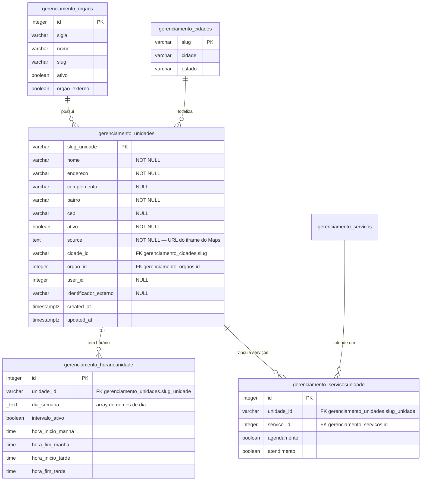

# Modelagem lógica — `gerenciamento_unidades`

Documenta a entidade **Unidade** (unidade de atendimento física de um
órgão) e seus relacionamentos no banco `admin_prd` (Carta de Serviços).

## Contexto

- **Unidade** representa um ponto de atendimento presencial de um órgão
  do Estado de MS (ex.: um CIRETRAN do DETRAN, uma agência da SEFAZ,
  uma delegacia da PCMS).
- A tabela é populada por cadastro no admin e, quando disponível, por
  integração externa. O campo `identificador_externo` guarda o id no
  sistema de origem (ex.: SGeo) quando aplicável.
- O campo `source` **não é o "sistema de origem"** apesar do nome — na
  base atual (DETRAN) ele armazena a **URL do `<iframe>` embed do
  Google Maps** exibida no portal para localizar a unidade. Ao ler
  cuidado com o tamanho (HTML inteiro numa linha).
- Uma unidade **pertence a exatamente um órgão** (`orgao_id`, NOT NULL)
  e **fica em exatamente uma cidade** (`cidade_id`, NOT NULL).
- Não há relacionamento direto entre `gerenciamento_unidades` e
  `gerenciamento_servicos` no schema atual — a vinculação
  serviço↔unidade, quando existe, é feita por outra estrutura fora do
  escopo deste documento.

## Diagrama ER



### Cardinalidades

| Relação | Cardinalidade | Regra |
|---|---|---|
| `orgaos` → `unidades` | 1 : N | Um órgão tem N unidades; toda unidade tem 1 órgão (`orgao_id NOT NULL`). |
| `cidades` → `unidades` | 1 : N | Uma cidade abriga N unidades; toda unidade fica em 1 cidade (`cidade_id NOT NULL`). |
| `unidades` → `horariounidade` | 1 : N | Uma unidade pode ter N faixas de horário (ex.: manhã+tarde de segunda a sexta, ou sábado só de manhã). Zero linhas = sem horário cadastrado. |
| `unidades` → `servicosunidade` → `servicos` | N : N | Uma unidade atende N serviços; um serviço pode ser prestado em N unidades. Tabela de junção com flags `agendamento` / `atendimento`. |

### Nota importante — FK implícita

`gerenciamento_unidades` **não declara constraints de FOREIGN KEY** no
schema (`information_schema.table_constraints` retorna vazio para
`FOREIGN KEY` nessa tabela). O relacionamento é convencional, mantido
por regra de aplicação:

- `unidades.orgao_id` (integer) ↔ `orgaos.id` (integer)
- `unidades.cidade_id` (varchar) ↔ `cidades.slug` (varchar)

Consequência: é possível existir `orgao_id` órfão (apontando para id
inexistente). Toda query de leitura deve usar `JOIN` (não `LEFT JOIN`)
quando o órgão é obrigatório pra semântica, e o extrator deve tolerar
`NULL` em `c.cidade` / `c.estado` via `LEFT JOIN` + `COALESCE`.

## Dicionário de dados

### `gerenciamento_unidades`

| coluna | tipo | null | descrição |
|---|---|---|---|
| `slug_unidade` | varchar | NO | Identificador único da unidade (PK). Usado em URLs do portal. |
| `nome` | varchar | NO | Nome de exibição da unidade (ex.: "CIRETRAN Campo Grande"). |
| `endereco` | varchar | NO | Logradouro + número. |
| `complemento` | varchar | YES | Sala, andar, bloco. |
| `bairro` | varchar | NO | Bairro. |
| `cep` | varchar | YES | CEP em texto (com ou sem hífen). |
| `ativo` | boolean | NO | Se `true`, unidade aparece no portal. |
| `source` | text | NO | URL do `<iframe>` embed do Google Maps da unidade (nome enganoso — não é "origem do registro"). |
| `cidade_id` | varchar | NO | FK implícita → `gerenciamento_cidades.slug`. |
| `orgao_id` | integer | NO | FK implícita → `gerenciamento_orgaos.id`. |
| `user_id` | integer | YES | Usuário do admin que cadastrou. |
| `identificador_externo` | varchar | YES | Id no sistema de origem (quando `source != 'manual'`). |
| `created_at` | timestamptz | NO | Data/hora de criação. |
| `updated_at` | timestamptz | NO | Data/hora da última alteração. |

### `gerenciamento_orgaos` (colunas usadas por Unidades)

| coluna | tipo | descrição |
|---|---|---|
| `id` | integer | PK do órgão. |
| `sigla` | varchar | Sigla curta (ex.: `DETRAN`, `SEFAZ MS`). |
| `nome` | varchar | Nome completo do órgão. |
| `slug` | varchar | Slug para URL. |
| `ativo` | boolean | Se `false`, órgão está descontinuado. |
| `orgao_externo` | boolean | Marca órgãos federais/municipais que aparecem por integração. |

### `gerenciamento_cidades`

| coluna | tipo | descrição |
|---|---|---|
| `slug` | varchar | PK — slug da cidade (ex.: `campo-grande`). |
| `cidade` | varchar | Nome da cidade. |
| `estado` | varchar | UF (ex.: `MS`). |

## Query de referência (todos os órgãos)

Definida em `src/extracao_carta/queries.py` como `UNIDADES_COM_ORGAO`
e exposta pela função `unidades_com_orgao(conn)`. Retorna todas as
unidades com sigla + nome do órgão para permitir filtro fácil no XLSX:

```sql
SELECT
    COALESCE(o.sigla, '')                  AS sigla_orgao,
    COALESCE(o.nome, '')                   AS nome_orgao,
    u.slug_unidade,
    u.nome                                 AS nome_unidade,
    u.endereco,
    COALESCE(u.complemento, '')            AS complemento,
    u.bairro,
    COALESCE(u.cep, '')                    AS cep,
    COALESCE(c.cidade, '')                 AS cidade,
    COALESCE(c.estado, '')                 AS estado,
    u.ativo,
    u.source,
    COALESCE(u.identificador_externo, '')  AS identificador_externo,
    u.created_at,
    u.updated_at
FROM gerenciamento_unidades u
JOIN gerenciamento_orgaos     o ON u.orgao_id  = o.id
LEFT JOIN gerenciamento_cidades c ON u.cidade_id = c.slug
ORDER BY sigla_orgao, estado, cidade, nome_unidade;
```

Filtrar depois no Excel via `Dados → Filtro` (já ligado por
`ws.auto_filter`), ou em SQL adicionando `WHERE o.sigla = 'DETRAN'`
(ou outra sigla).
